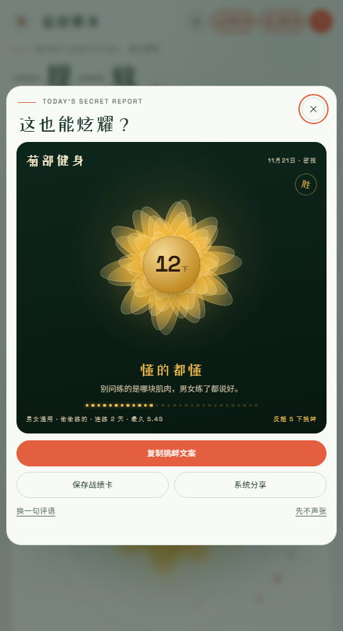

# 菊部健身

一提一放，功力暴涨。

按住，往上提，等光环满一圈再松开。每天三十下，别人看你在赏花，其实你在暗中练底盘。男女通用，一个懂的都懂、发给朋友会心一笑的小游戏。

[**在线试玩 →**](https://humanv.github.io/kegel-exercise/)（也支持备选文案皮肤：[`?brand=toutou`](https://humanv.github.io/kegel-exercise/?brand=toutou)「偷偷变强」）


## 玩法

- **按住**圆盘或全局长按 **空格键** 暗中发力：68 瓣暖金菊花会弹性拧紧，花心露出憋住使劲的可爱小表情并微微发抖、泛起红晕，光粒被吸进中心。
- **满格**时花心切换成得意星星眼、弹出「稳了！」飘字并伴随清越磬音；继续按住超过目标时长 1.5 秒进入「狠人加码」态，花心透出流金光芒。
- **松开**后花瓣带果冻般的弹性回弹摊开，花心切到舒爽放空表情，光粒向外散开并弹出「功力 +1 / 底盘 +1」等趣味浮标。
- **没满就松手**会触发花朵摇头泄气动画与豆豆眼表情提示「太快了」；放松期抢跑点击会摇头提醒「先松透！」。
- 收和放使用同一套时间：默认入门 **3 秒**，也可在左侧切换 **进阶 5 秒** 或 **狠人 8 秒**；按得更久，回血也更久（上限 10 秒）。
- 每完成一下，外圈就弹跳点亮一颗小星，三十下连成今日封神圈。
- 第 10、20、30 下会出现印章（稳 / 狠 / 神）；页面氛围光晕、星环和今日状态分四阶段演进，并配有男女通用的含蓄双关动态文案池。
- 左侧微录会保留**近七日轨迹**、**连续打卡天数**、**历史累计次数**与**今日最久**。
- 支持鼠标、触屏和全局空格键；右上角可手动切换**浅色 / 深色外观**，手机与深色模式均已适配。

## 拿去炫耀

右上角的箭头或底部的「拿去炫耀」会生成一张今日密报战绩卡，包含暖金菊花、今日次数、随机称号、趣味评语和连练记录。

- **复制挑衅文案**：生成一个带 `?c=你的次数` 的链接，朋友打开后会看到“收到挑衅：有人偷偷练了 N 下”。
- **保存战绩卡**：纯前端离线生成 900×1220 高清 PNG 密报图，支持一键下载或随系统带图分享。
- **换一句评语**：不满意当前称号或评语时可随时换一套再发。
- **反杀闭环**：超过对方后会触发「胜」字印章，按钮自动切换为「反杀炫耀」并生成专属回怼文案。
- 挑战链接最多把对方的目标带到 30 下，不会鼓励无限加练。



## 声音

右上角有两个独立开关：

- **音乐开 / 关**：连续背景音乐。
- **音效开 / 关**：起手声、随发力进度上扬的连续共鸣音、满格磬音、松透呼息、未达标和里程碑提示音。

针对手机端做了专门适配（含 iOS 静音开关媒体通道兼容与手机扬声器中频优化）。所有声音均由浏览器 Web Audio 实时合成，不加载外部音轨。

## 运行

无需构建，也没有运行依赖。直接双击 `index.html` 即可打开。

如需通过本地服务器访问：

```powershell
python -m http.server 8000
# 浏览器打开 http://localhost:8000
```

页面使用 Google Fonts；字体加载失败时会回退到系统中文字体，不影响功能。

## 文件

- `index.html`：完整页面，样式、交互脚本、Canvas 海报绘制和声音合成逻辑均内联。
- `preview.png`：页面预览图。
- `share-preview.png`：战绩卡预览。

## 技术

原生 HTML、CSS 和 JavaScript。历史与每日记录保存在浏览器 `localStorage`；Web Audio 负责实时背景音乐和独立音效。

<details>
<summary>开发者说明：底层节奏与健康边界</summary>

游戏不展示枯燥训练说明，但交互节奏参考了常见的盆底肌训练入门方案：收紧约 3 秒、完全放松约 3 秒，每天约 30 次。游戏把节奏藏在光圈、表情和松透动画里。

这不是医疗建议。孕期、产后、近期盆腔手术、盆底疼痛或练习后症状加重时，请先咨询医生或盆底康复师；疑似盆底高张力时不应默认加练收缩。页面底部保留“身体不舒服就停，量力而行”的简短提示。

参考资料：

- [NICE NG123：女性尿失禁与盆腔器官脱垂管理](https://www.nice.org.uk/guidance/ng123)
- [NHS Leeds：男性盆底肌练习](https://leedscommunityhealthcare.nhs.uk/our-services-a-z/continence-urology-and-colorectal-cucs/bladder-problems-cucs/pelvic-floor-exercises-for-men-cucs/)
- [NHS LSCFT：女性盆底肌练习说明](https://www.lscft.nhs.uk/our-services/service-finder-z/continence-service/pelvic-floor-physiotherapy/pelvic-floor-muscle-exercise-information-sheet-women)
- [NHS MKUH：孕期与产后盆底护理](https://www.mkuh.nhs.uk/maternity-services/your-pregnancy-journey/postnatal-care/care-of-the-pelvic-floor-and-perineum)
- [Torosis et al., A Treatment Algorithm for High-Tone Pelvic Floor Dysfunction](https://pmc.ncbi.nlm.nih.gov/articles/PMC10953682/)

</details>
