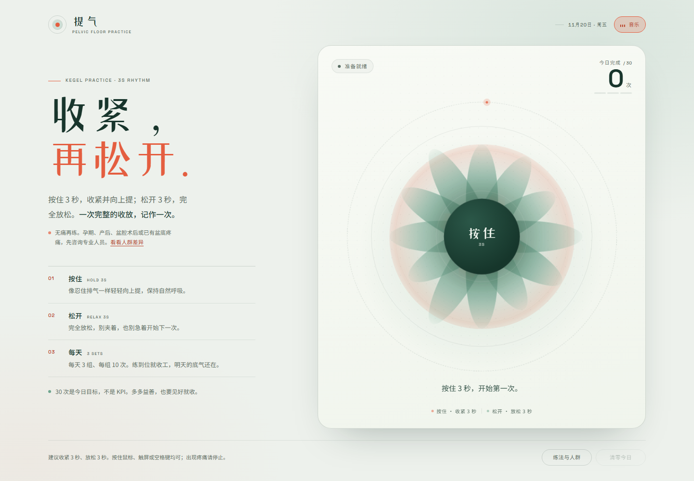

# 提气 · 凯格尔练习

一个轻量的凯格尔练习网页小游戏。收紧 3 秒才计为一次，随后引导你完整放松。每天 3 组、每组 10 次，一共 30 次。

[**在线试玩 →**](https://humanv.github.io/kegel-exercise/)



## 现在有什么

- **有节奏的收放**：按住圆盘收紧，满 3 秒后提示松开；松开后计时引导放松，放松结束才能开始下一次。收不满 3 秒不会计入。
- **今日目标与成就**：每日目标 30 次，按 3 组 × 10 次显示进度。完成第 10、20、30 次时会有成就提示、印章、金色状态和音效；达到 30 次后仍可量力加练，但不再追加奖励。
- **轻音乐**：背景音乐由浏览器通过 Web Audio 实时合成，不加载外部音轨；右上角可随时关闭。首次按住圆盘或点击音乐按钮后开始播放。
- **不同人群的练法**：页面内附「练法与人群」说明，区分日常保养、孕期/产后、男性/前列腺术后、盆底疼痛/高张力等情况，并列出停止练习和就医提示。
- **细节**：提供自然呼吸、排空膀胱、避免夹臀/夹腿/憋气等提示；支持鼠标、触屏和空格键；适配手机、深色模式与 `prefers-reduced-motion`。

## 专业边界

- 本页采用的是一个**通用入门节奏**：收紧 3 秒、放松 3 秒；可逐步向 5–10 秒过渡，但先保证动作准确、完全放松。
- 每日 30 次是通用练习目标，不是对所有人的处方。医生或盆底康复师给了不同剂量时，以专业方案为准。
- 本页只练**慢速收放**。一些完整训练方案还包含快速收缩，需按专业方案另行练习。
- 这是一般性的健康教育内容，不构成诊断或个体化医疗建议。有疼痛、孕产期特殊情况、近期盆腔手术或症状加重时，先停止并咨询医生/盆底康复师。
- 盆底肌并不是“越紧越好”。疑似高张力或盆底疼痛时，应优先做盆底评估和放松/协调训练，不要用本游戏硬练。

## 运行

无需构建，也没有运行依赖。直接双击 `index.html` 即可打开。

如需通过本地服务器访问：

```powershell
python -m http.server 8000
# 浏览器打开 http://localhost:8000
```

页面使用 Google Fonts；字体加载失败时会回退到系统中文字体，不影响功能。

## 文件

- `index.html`：完整页面，样式、交互脚本和音乐合成逻辑均内联。
- `preview.png`：页面预览图。

## 技术

原生 HTML、CSS 和 JavaScript。Web Audio 负责实时环境音乐与提示音；今日次数和音乐开关保存在浏览器 `localStorage` 中。

## 参考资料

- [NICE NG123：女性尿失禁与盆腔器官脱垂管理](https://www.nice.org.uk/guidance/ng123)
- [NHS Leeds：男性盆底肌练习](https://leedscommunityhealthcare.nhs.uk/our-services-a-z/continence-urology-and-colorectal-cucs/bladder-problems-cucs/pelvic-floor-exercises-for-men-cucs/)
- [NHS LSCFT：女性盆底肌练习说明](https://www.lscft.nhs.uk/our-services/service-finder-z/continence-service/pelvic-floor-physiotherapy/pelvic-floor-muscle-exercise-information-sheet-women)
- [NHS MKUH：孕期与产后盆底护理](https://www.mkuh.nhs.uk/maternity-services/your-pregnancy-journey/postnatal-care/care-of-the-pelvic-floor-and-perineum)
- [NHS Right Decisions：孕期盆底练习](https://www.rightdecisions.scot.nhs.uk/patient-information-leaflets/primary-community-services/physiotherapy/pelvic-floor-exercises-during-pregnancy/)
- [Torosis et al., A Treatment Algorithm for High-Tone Pelvic Floor Dysfunction (2024)](https://pmc.ncbi.nlm.nih.gov/articles/PMC10953682/)
